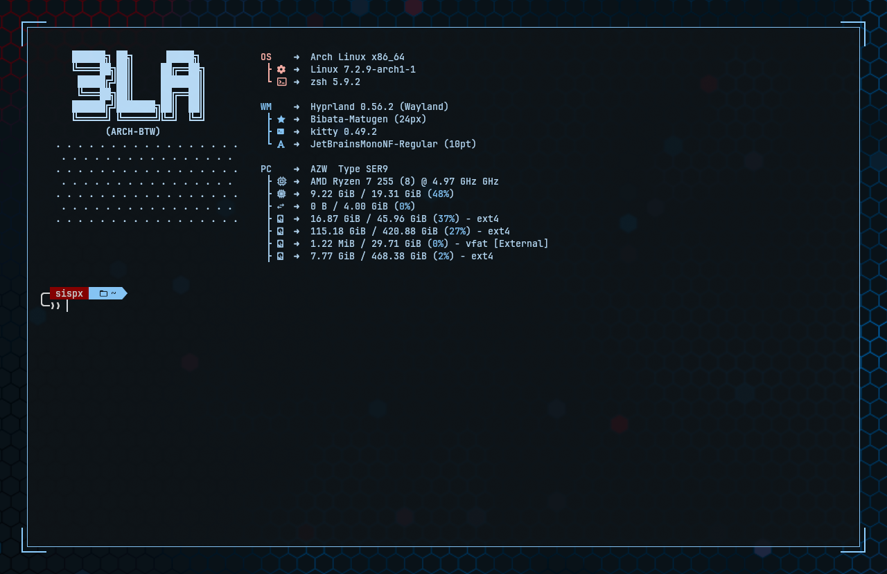

# 3LA-Corners

Draws decorative corner brackets outside every window's border. Each corner
gets two line segments (horizontal + vertical) offset outside the window
border, like a targeting reticle. The focused window and unfocused windows can
be given different colours, and either window spawn or focus gain can trigger
a flash.



*Corner brackets with glow around a focused kitty (1 px Hyprland border on).*

Part of [Hypr-3LA](../README.md).

## Contents

- [Build and load](#build-and-load)
- [Config](#config)
- [Flashing](#flashing)
- [Glow](#glow)
- [Joining lines](#joining-lines)
- [Active / inactive styling](#active--inactive-styling)
- [Example config](#example-config)
- [Notes](#notes)

## Build and load

Requires Hyprland 0.57.0 headers (see the [main README](../README.md#requirements)).
Works on both the GL and Vulkan renderers.

```sh
make                                              # → 3LA-Corners.so
hyprctl plugin load "$PWD/3LA-Corners.so"         # absolute path required
```

Or via hyprpm: `hyprpm enable 3LA-Corners`. Rebuild after every Hyprland
update.

## Config

Defaults shown:

```lua
hl.config({ plugin = { ["3la_corners"] = {
    enabled = 1,          -- 0 = off: no brackets and no reserved space, applied
                          -- live (windows snap back to their plain geometry)
    offset = 10,          -- gap (px) between the window border and the brackets
    length = 100,         -- arm length (px) of each bracket, from the corner
    thickness = 2,        -- line thickness (px)

    ["col.active"] = 0,   -- focused-window bracket color.
                          -- 0 = follow general:col.active_border (first color);
                          -- otherwise e.g. "rgba(33ccffee)"
    ["col.inactive"] = 0, -- unfocused-window bracket color.
                          -- 0 = follow col.active if that is set, else
                          -- general:col.inactive_border (first color)

    flash_count = 3,      -- times the brackets flash when a window SPAWNS (0 = off)
    flash_duration = 150, -- spawn flash on/off phase duration (ms)

    flash_on_focus = 0,         -- flash when a window gains FOCUS (0 = off, 1 = on)
    focus_flash_count = 3,      -- times the brackets flash per focus change (0 = off)
    focus_flash_duration = 150, -- focus flash on/off phase duration (ms)

    glow = 0,             -- soft halo behind the brackets DURING a flash burst
                          -- (0 = off). Only drawn while a burst is running.
    ["glow.size"] = 12,   -- halo spread distance (px)
    ["glow.strength"] = 0.5, -- overall halo intensity (0..1)
    ["col.glow"] = 0,     -- 0 = follow the bracket's own color

    lines = 0,               -- lines joining the brackets along each edge (0 = off)
    ["lines.thickness"] = 1, -- joining line thickness (px), capped at `thickness`
    ["lines.offset"] = 0,    -- shift lines inward toward the window (px, negative = outward)
    ["col.lines"] = 0,       -- 0 = follow the bracket's own color
} } })
```

Live-tweak and inspect:

```sh
hyprctl eval 'hl.config({ plugin = { ["3la_corners"] = { length = 40, glow = 1 } } })'
hyprctl getoption plugin:3la_corners:enabled
```

## Flashing

A burst is `count` on-pulses, each phase lasting `duration` ms, after which
the brackets settle to steady on. The two burst types are configured
independently:

| Trigger | Count | Duration | Gate | Priority |
|---|---|---|---|---|
| window spawns | `flash_count` | `flash_duration` | always on | preempts any running burst |
| window gains focus | `focus_flash_count` | `focus_flash_duration` | `flash_on_focus = 1` | dropped while a spawn burst runs |

The focus flash needs **both** `flash_on_focus = 1` and a non-zero
`focus_flash_count`. `flash_count = 0` disables the spawn flash only.

**The spawn burst has priority.** A new window takes focus in the same tick it
opens, so without this rule the focus burst would replace every spawn burst
and `flash_count` / `flash_duration` would have no visible effect.

- Burst parameters are captured when the burst is armed, so changing options
  mid-burst doesn't retime it.
- Re-triggering a focus flash mid-burst restarts the sequence rather than
  queueing, so rapid alt-tabbing stays in step.
- Expiry is time-based, not frame-based, so a window that spawns fullscreen
  (brackets hidden) doesn't get stuck mid-burst.

## Glow

A soft halo behind the brackets, off by default (`glow = 0`).

- **Only renders while a flash burst is running** — not on every frame — so it
  reads as part of the flash. `glow = 1` does nothing visible if both flash
  types are disabled.
- **Not a real blur.** A plugin can't reach Hyprland's shadow shader, so this
  is four expanded copies of each bracket box drawn behind it with fading
  alpha. It reads best as a tight halo (≤ ~16 px); larger sizes show banding.
- `col.glow = 0` follows the bracket's colour including its flash alpha, so
  the halo pulses with it.
- The damage region grows by `glow.size` while `glow` is on, so moving or
  resizing a window leaves no trails.

## Joining lines

`lines = 1` draws a line between the arm tips of neighbouring brackets on
every edge, turning the brackets into a full frame. The lines sit flush with
the brackets' outer edge, are `lines.thickness` px thick (never thicker than
the brackets), and flash along with them. `lines.offset` shifts them inward;
a negative value pushes them outward. `col.lines = 0` follows the bracket
colour.

## Active / inactive styling

The brackets render at **full alpha regardless of focus**, decoupled from
window opacity. None of these affect them:

- `decoration:active_opacity` / `decoration:inactive_opacity`
- per-window `opacity` window rules
- window fade-in/out and workspace-move alpha

Only the configured colour's alpha and the flash envelope set the final alpha.
The trade-off: brackets pop in at full opacity when a window opens rather than
fading with it.

> **If unfocused brackets look "dimmed", check `col.inactive` first.** With
> `col.inactive = 0` the brackets follow `general:col.inactive_border`, which
> in most themes is a darker shade. Set both colours explicitly for identical
> brackets in both states.

Colour resolution order:

| State | Order |
|---|---|
| focused | `col.active` → `general:col.active_border` → white |
| unfocused | `col.inactive` → `col.active` → `general:col.inactive_border` → white |

```lua
hl.config({ plugin = { ["3la_corners"] = {
    ["col.active"] = "rgba(33ccffee)", ["col.inactive"] = "rgba(6a7a85ff)",
} } })
```

## Example config

Themed from matugen colour globals (`primary`, `on_secondary_fixed` —
whatever your colour template defines):

```lua
pcall(hl.config, {
    plugin = {
        ["3la_corners"] = {
            enabled = 1,
            offset = 6,                         -- gap (px) between border and brackets
            length = 36,                        -- bracket arm length (px)
            thickness = 2,
            ["col.active"] = primary,
            ["col.inactive"] = primary,         -- same as active = no focus change
            flash_duration = 150,
            flash_on_focus = 1,
            focus_flash_count = 3,
            focus_flash_duration = 75,
            glow = 1,
            ["glow.size"] = 10,
            ["glow.strength"] = 0.3,
            lines = 1,
            ["lines.thickness"] = 1,
            ["col.lines"] = on_secondary_fixed,
        }
    }
})
```

## Notes

- The bracket ring is *reserved* space: tiled windows shrink by
  `offset + thickness` per side so brackets never overlap neighbours.
- **With 3LA-TitleBars**, the top pair of brackets automatically frames the
  outside of the bar rather than the window's own top edge. The gap between
  the top brackets and the bar is `gap.top - thickness`; the side gap is
  `offset`. Set them equal (e.g. `offset = 8`, `thickness = 2`,
  `gap.top = 10`) for an even frame all round.
- **With 3LA-MilSpec**, the top brackets collide with the frame's top edge.
  Running both is not recommended.
- Brackets are hidden on fullscreen windows.
- Focus changes repaint immediately (listens on `window.active`). While a
  flash runs the decoration damages itself every frame, so
  `flash_on_focus = 1` costs a short burst of redraws per focus change; on a
  loaded GPU prefer a low `focus_flash_count`.
- Closing a window never leaves its brackets on screen: `window.close` damages
  them while geometry is valid, and a client that exits on its own falls back
  to damaging the whole output it was last drawn on.
- `-g` is left out of release builds on purpose: it inflated this `.so`
  roughly 33× with no codegen benefit. Use `make debug` for a readable
  backtrace.
