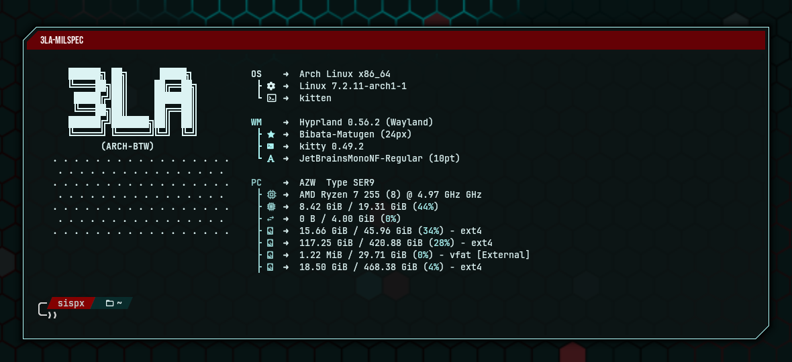
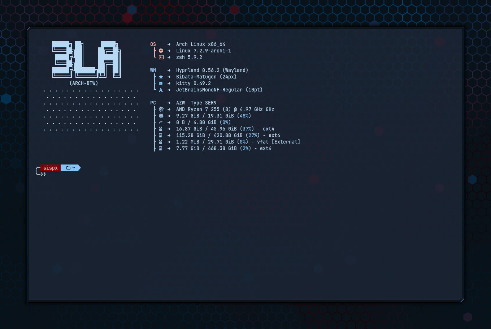

# 3LA-MilSpec

Draws a stroked frame around every window, offset outside its core border,
with the **top-left and bottom-right corners chamfered** (cut at 45°) while
top-right and bottom-left stay square — a "mil-spec" HUD panel outline.
Optionally reserves a solid **title bar inside the frame**, between the
frame's top edge and the window, showing the window's title in uppercase.



*With title bar.*



*Without title bar: both corners cut via the corner covers.*

The frame (plus the optional background fill, the window corner covers, and
the bar's fill so it follows the top-left cut) is drawn with cairo into one
antialiased texture at the monitor's pixel scale, cached per window, and only
redrawn when its size, scale, colours or the relevant options change.

Part of [Hypr-3LA](../README.md).

## Contents

- [Build and load](#build-and-load)
- [Config](#config)
- [Custom bar titles](#custom-bar-titles)
- [Drop shadow](#drop-shadow)
- [Background fill](#background-fill)
- [Window corner covers](#window-corner-covers)
- [Layout](#layout)
- [Title bar only for some titles](#title-bar-only-for-some-titles)
- [Toggling the title bar per-window](#toggling-the-title-bar-per-window)
- [Example config](#example-config)
- [Notes](#notes)

## Build and load

Requires Hyprland 0.56.2 headers (see the [main README](../README.md#requirements)).
This is the only plugin that links an extra library, `libcairo`, which
Hyprland itself already depends on.

```sh
make                                              # → 3LA-MilSpec.so
hyprctl plugin load "$PWD/3LA-MilSpec.so"         # absolute path required
```

Or via hyprpm: `hyprpm enable 3LA-MilSpec`. Rebuild after every Hyprland
update. Only tested on the GL renderer.

## Config

Defaults shown:

```lua
hl.config({ plugin = { ["3la_milspec"] = {
    enabled = 1,          -- 0 = off: no frame and no reserved space, applied
                          -- live (windows snap back to their plain geometry)
    offset = 10,          -- gap (px) between the window's border and the frame
    ["offset.top_flush_class"] = "",
                          -- regex of window classes that sit flush against
                          -- the top stroke (no `offset` on the top edge only)
                          -- while they have no title bar; empty = none.
                          -- See Layout.
    thickness = 2,        -- frame stroke width (px)
    chamfer = 15,         -- leg length (px) of the 45° cut on the top-left and
                          -- bottom-right corners, measured on the frame's
                          -- outer edge (0 = square corners)

    ["col.active"] = 0,   -- focused-window frame color.
                          -- 0 = follow general:col.active_border (first color);
                          -- otherwise e.g. "rgba(33ccffee)"
    ["col.inactive"] = 0, -- unfocused-window frame color.
                          -- 0 = follow col.active if that is set, else
                          -- general:col.inactive_border (first color)
    ["col.background"] = 0, -- fill between the frame and the window (+ border),
                            -- under the title bar and stroke. 0 = transparent;
                            -- the color's own alpha applies, e.g. "rgba(0a141c99)"

    corners = 1,               -- cut the window's own corners like the frame:
                               -- bottom-right always, top-left only when the
                               -- window has no title bar (0 = off). The part past
                               -- the stroke is clipped from the client; inside
                               -- the frame a painted cover fills the gap.
    ["corners.size"] = -1,     -- painted cover inside the frame. -1 = auto: a
                               -- band `offset` wide along the inside of the
                               -- chamfer; >= 0 = leg length (px), 0 = no cover
    ["corners.col"] = 0,       -- cover color. 0 = follow col.background; if that is
                               -- 0 too, an opaque near-black 0xff0a0f14

    titlebar = 0,              -- reserve a title bar inside the frame (0 = off, 1 = on)
    ["titlebar.height"] = 20,  -- bar height (px)
    ["titlebar.offset"] = 4,   -- gap (px) between the frame stroke's inner
                               -- edge and the bar, on its top/left/right
    ["titlebar.offset.top"] = -1,   -- per-side overrides of titlebar.offset
    ["titlebar.offset.left"] = -1,  -- (-1 = use titlebar.offset)
    ["titlebar.offset.right"] = -1,
    ["titlebar.gap"] = 4,      -- gap (px) between the bottom of the bar and
                               -- the window's border
    ["col.titlebar.active"] = 0,   -- focused-window bar fill color.
                                   -- 0 = follow the frame's col.active color
    ["col.titlebar.inactive"] = 0, -- unfocused-window bar fill color.
                                   -- 0 = follow col.titlebar.active if that is
                                   -- set, else the frame's col.inactive color
    ["titlebar.opacity.active"] = 1.0,   -- opacity multiplier (0..1) on the bar
                                         -- fill and title text, focused window
    ["titlebar.opacity.inactive"] = 1.0, -- same, unfocused windows. 0 = no bar
                                         -- or text, but the space stays reserved.
                                         -- Stroke, col.background, corner covers
                                         -- and shadow are not affected
    ["text.size"] = 12,        -- title font size (px)
    ["text.font"] = "",        -- title font family (empty = follow misc:font_family)
    ["col.text.active"] = 0,   -- focused-window title text color.
                               -- 0 = black or white, whichever contrasts
                               -- with the bar
    ["col.text.inactive"] = 0, -- unfocused-window title text color.
                               -- 0 = follow col.text.active if that is set,
                               -- else black/white contrast

    ignore_class = "",    -- regex of window classes to never frame (empty = none)
    ignore_title = "",    -- regex of window titles to never frame (empty = none)

    ["titlebar.ignore_class"] = "", -- regex of window classes that keep the
                                    -- frame but get no title bar (empty = none)
    ["titlebar.ignore_title"] = "", -- regex of window titles that keep the
                                    -- frame but get no title bar (empty = none)

    ["titlebar.require_title_class"] = "", -- regex of window classes that only
                                           -- get a title bar while their title
                                           -- matches titlebar.require_title
                                           -- (empty = none)
    ["titlebar.require_title"] = "",       -- regex such a window's title must
                                           -- match to get a bar (empty = never)

    title_rules = "",               -- custom bar titles; see "Custom bar titles"

    frame = 1,                      -- draw the frame stroke (0 = hide it on every
                                    -- window; spacing and title bar unchanged)
    ["frame.ignore_class"] = "",    -- regex of window classes that get no frame
                                    -- stroke (empty = none)
    ["frame.ignore_title"] = "",    -- regex of window titles that get no frame
                                    -- stroke (empty = none)

    native_shadow = 0,              -- 0 = hide Hyprland's decoration:shadow on framed
                                    -- windows (its square corner pokes past the chamfer);
                                    -- 1 = leave it alone
    shadow = 1,                     -- drop shadow following the frame (0 = off)
    ["shadow.range"] = 30,          -- shadow size (px), as decoration:shadow:range
    ["shadow.render_power"] = 4,    -- falloff power 1-4 (higher = tighter)
    ["shadow.sharp"] = 0,           -- 1 = hard-edged, no falloff
    ["shadow.offset.x"] = 0,        -- shift (px); negative = left
    ["shadow.offset.y"] = 0,        -- shift (px); negative = up
    ["shadow.scale"] = 1.0,         -- 0.0-1.0, as decoration:shadow:scale
    ["col.shadow.active"] = "rgba(000000ee)", -- focused-window shadow color
    ["col.shadow.inactive"] = 0,    -- unfocused; 0 = follow col.shadow.active
    ["shadow.ignore_class"] = "",   -- regex of window classes that get no shadow
    ["shadow.ignore_title"] = "",   -- regex of window titles that get no shadow
} } })
```

Live-tweak and inspect (the Lua parser rejects `hyprctl keyword`):

```sh
hyprctl eval 'hl.config({ plugin = { ["3la_milspec"] = { chamfer = 30, titlebar = 1, ["titlebar.height"] = 22 } } })'
hyprctl getoption plugin:3la_milspec:chamfer
```

## Custom bar titles

`title_rules` replaces the text on the title bar without touching the window's
real title (used elsewhere for matching, alt-tab, etc.). It uses the same
format and matching as 3LA-TitleBars'
[`title_rules`](../3LA-TitleBars/README.md#custom-titles), so one string can
drive both plugins:

```lua
-- 'class_regex,title_regex,override text' rules, separated by ';'.
-- Either regex may be empty to match any class/title. First match wins.
title_rules = ",^(btop)$,SYSTEM MONITOR;^(firefox)$,,WEB BROWSER",
```

A window whose title matches `^(btop)$` (any class) shows "SYSTEM MONITOR"; a
`firefox` window (any title) shows "WEB BROWSER"; every other window keeps its
own title.

The rules:

- **Three fields, always.** `class_regex,title_regex,override text`. Only the
  first two commas split fields, so the override text may contain commas. A
  2-field shorthand like `^(btop)$,SYSTEM MONITOR` is read as a *class* regex
  with no override field and skipped — leave the class empty instead:
  `,^(btop)$,SYSTEM MONITOR`.
- **Empty regex = any.** Both regexes must match for the rule to apply.
- **Search, not full match.** Regexes are `std::regex_search` (ECMAScript), so
  `kitty` also matches `kitty-dropdown`; anchor with `^...$` for exact names.
- **First match wins.** Put specific rules before broad ones.
- **One leading space is trimmed** from the title regex and the override text.
  Further spaces are kept (useful for indenting a title).
- **Empty override text** (`^(foo)$,,`) leaves the bar drawn but blank.
- **Bad rules are skipped individually.** A rule missing a field or holding an
  invalid regex raises an in-session notification naming it; the rest of the
  list still applies.
- **Matching uses the real class/title**, so `ignore_*`, `titlebar.ignore_*`,
  `frame.ignore_*` and `shadow.ignore_*` all see the real title, never the
  override.
- **Live.** The string is re-parsed only when it changes, and a window's bar
  text is re-resolved whenever its title or class changes (e.g. a terminal
  running `btop` or `ssh`).
- **Bar only.** Overrides only show where a bar is drawn.
- **Styled like any title:** uppercased (ASCII only) and drawn with `text.*` /
  `col.text.*`, faded by `titlebar.opacity.*`.

To keep both plugins in step, build the string once in a Lua local and pass it
to both — see [Example config](#example-config).

## Drop shadow

Hyprland's own `decoration:shadow` is a rounded rectangle around the window
itself, so it sits inside the frame and ignores the chamfers. The plugin's
shadow uses the same falloff as Hyprland's `shadow.glsl`
(`alpha = ((range - d) / range) ^ render_power` for distance `d` outside the
shape) and the same geometry order (grow by `range`, scale about the centre,
then offset). It is measured from the frame's **outer edge**, so it follows
both 45° cuts and the title bar band.

- Hyprland's own `decoration:shadow` is hidden on framed windows by default
  (`native_shadow = 0`): the plugin sets the window's `noshadow` property at
  the `setprop` priority, as `hyprctl setprop noshadow 1` would, and lifts it
  again when the frame is hidden or the plugin unloads. Unframed windows keep
  it. `native_shadow = 1` leaves it alone, and then both shadows are drawn.
- Only shows **outside** the frame, never in the gap between frame and window.
- Drawn **above** the window (unlike Hyprland's shadow, which sits under it),
  so it runs along the whole chamfer: through the corners clipped past the cut
  and, without the clip, over the painted covers there.
- `frame = 0` / `frame.ignore_*` hide only the stroke; the shadow still traces
  the frame shape. `enabled = 0` or `ignore_class` / `ignore_title` also
  remove the shadow.
- `shadow.scale` well below 1 pulls the shadow inside the frame and hides it.
- Ignores the renderer's fade alpha, like the frame.
- Built on the CPU into up to 4 cached textures covering only the ring around
  the frame; rebuilt when size, scale, colour or a shadow option changes.

## Background fill

`col.background` paints the space between the frame and the window, like the
panel behind a HUD frame. Default `0` = transparent.

- Fills the frame's chamfered outline up to the stroke's **inner** edge. With
  the stroke hidden it reaches to where the stroke's outer edge would be.
- The window and Hyprland's border are cut out, honouring `rounding` and
  `rounding_power`. Nothing is painted behind the window, so a translucent
  window never shows the fill through it.
- Drawn into the same cached texture as the frame, under the title bar and
  the stroke. The colour's alpha is respected.
- Windows with no frame get no fill.

```sh
hyprctl eval 'hl.config({ plugin = { ["3la_milspec"] = { ["col.background"] = "rgba(0a141c99)" } } })'
hyprctl eval 'hl.config({ plugin = { ["3la_milspec"] = { ["col.background"] = 0 } } })'   # transparent
```

## Window corner covers

The frame is chamfered but the app inside is still a square window.
`corners = 1` (the default) cuts the window's own corner like the frame:

- **Bottom-right:** always cut.
- **Top-left:** cut wherever the chamfer reaches the window. With a MilSpec
  title bar the bar carries the corner and the window sits below its band, so
  the window itself is only cut by a chamfer deeper than that band.

Two things happen at such a corner:

- **Past the frame's outer edge the client is clipped.** A client buffer is
  rectangular, so wherever the chamfer is deeper than the window's insets the
  app's corner would poke past the cut (7 px on an `offset.top_flush_class`
  window at offset 5 / thickness 1 / chamfer 14, 2 px otherwise). The plugin
  hooks `CSurfacePassElement::visibleRegion`, the clip Hyprland scissors every
  window surface with, and `opaqueRegion`, which the render pass culls
  everything underneath with, and subtracts that triangle from both, so
  nothing of the app is drawn there and the wallpaper and the
  [drop shadow](#drop-shadow) show through. 3LA-Tint follows the same clip.
  Popups are never clipped. A core `general:border_size > 0` is not clipped
  either; keep it 0 with chamfers. If a symbol is missing on a future Hyprland
  the plugin notifies once at load and falls back to the cover below painting
  over the corner.
- **Inside the frame a 45° triangle is painted over the window**
  (`corners.size`): by default a band `offset` wide along the inside of the
  stroke's diagonal, so the gap between the stroke and the app is the same
  along the chamfer as along the straight edges. It is a painted cover, not
  transparency: it reads as a cut when its colour matches the fill around it,
  which is why it follows `col.background` by default. `corners.size = 0`
  drops it and the app runs right up to the chamfer.

- Triangle legs are measured on the window **plus** its border, with only the
  diagonal antialiased. Covers are clamped to half the window's shorter side.
- `corners.size = -1` (default) is **auto**: the window's cut is placed
  parallel to the frame's inner diagonal, `offset` px inside it, so the
  diagonal gap equals the straight ones (also on `offset.top_flush_class`
  windows, whose top gap is 0). For stroke thickness T, chamfer C, offset o
  and the actual gaps gA / gB on the two edges meeting at the corner, the leg
  is `s = C + (T + o)·√2 − (T + gA) − (T + gB)`
  (thickness 1, offset 5, chamfer 14, both gaps 5 → 10.5 px). If s ≤ 0 no
  cover is drawn.
- Colour: `corners.col`, else `col.background`, else opaque `0xff0a0f14`.
  Always drawn fully opaque.
- Rounded windows: with a large `rounding` a sliver of the arc can show past
  the diagonal.
- Skipped on fullscreen windows and windows with no frame. `frame = 0` keeps
  the covers and the clip.

```sh
hyprctl eval 'hl.config({ plugin = { ["3la_milspec"] = { ["corners.size"] = 20, ["corners.col"] = "rgba(0a141cff)" } } })'
hyprctl eval 'hl.config({ plugin = { ["3la_milspec"] = { corners = 0 } } })'   # square corners
```

## Layout

Space is *reserved* on every edge, like the core border: tiled windows shrink
and floating windows are inset so nothing overlaps the frame. From the window
outward:

```
left / right / bottom:  window | border | offset | thickness
top (no bar):           window | border | offset | thickness
top (no bar, flush):    window | border | thickness
top (bar):              window | border | titlebar.gap | titlebar.height | titlebar.offset.top | thickness
```

"No bar" means `titlebar = 0`, a `titlebar.ignore_*` match, or the bar toggled
off. "Flush" is a no-bar window whose class matches `offset.top_flush_class`:
it drops `offset` on the top edge only, for apps that draw their own title or
menu bar (VS Code, for example), so the frame hugs that bar. The auto corner
cover grows to match.

```sh
hyprctl eval 'hl.config({ plugin = { ["3la_milspec"] = { ["offset.top_flush_class"] = "^(code)$" } } })'
```

With the bar on, it sits `titlebar.offset.top` below the top stroke's inner
edge and `titlebar.gap` above the window, inset `titlebar.offset.left` /
`.right` from the side strokes, so it floats inside the outline like a
launcher-panel header. The bar gets its own 45° cut at the top-left, parallel
to the frame's. The title is left-aligned, padded clear of the cut,
ellipsised to fit and vertically centred.

## Title bar only for some titles

`titlebar.require_title_class` turns the bar into an opt-in for matching
classes: such a window gets **no** bar unless its current title also matches
`titlebar.require_title`. An empty `titlebar.require_title` means those
classes never get a bar.

The typical use is a terminal that should look plain locally but get a
labelled bar while it is running an SSH session (or a named tool like `btop`):

```lua
-- hosts you SSH into (placeholders; one list feeds both regexes below)
local ssh_hosts = { "server1", "server2" }

-- kitty only gets a bar while its title looks like SSH. kitty's shell
-- integration sets the raw command ("ssh host") on preexec, and the remote
-- PS1 usually sets "user@host:dir". "myhost" is your local hostname, so
-- local prompts don't count.
local ssh_title = table.concat({
    "^ssh ",
    "@(" .. table.concat(ssh_hosts, "|") .. ")\\b",
    "^(?![\\w.-]+@myhost:)[\\w.-]+@[\\w.-]+:",  -- any remote "user@host:" prompt
    "^(btop)$",
}, "|")

-- relabel those bars (title_rules is shared with 3la_titlebars)
local title_rules = table.concat((function()
    local rules = { ",^(btop)$,SYSTEM MONITOR" }
    for _, host in ipairs(ssh_hosts) do
        table.insert(rules, "^(kitty)$,@" .. host .. "\\b,Secure Shell: " .. host)
    end
    return rules
end)(), ";")

pcall(hl.config, { plugin = { ["3la_milspec"] = {
    titlebar = 1,
    title_rules = title_rules,
    ["titlebar.require_title_class"] = "^(kitty)$",
    ["titlebar.require_title"] = ssh_title,
} } })
```

- Re-checked on every `window.title` change, so the bar (and its reserved
  band) appears when the session starts and goes when it ends; the window
  repositions on the spot.
- Applied after the global checks: it does nothing while `titlebar = 0` or
  when the bar was toggled off. `titlebar.ignore_*` still removes the bar
  even when the required title matches.
- The frame itself is unaffected — only the bar.
- ECMAScript regex, so the negative lookahead `(?!...)` above works. In a Lua
  string a regex `\b` / `\w` is written `\\b` / `\\w`.

## Toggling the title bar per-window

`3la_milspec:toggle` flips the title bar on the currently **focused** window
only (independent of `titlebar.ignore_*`, reversible). The frame stays; only
the bar and its reserved band go. It does nothing while `titlebar = 0`.

```lua
-- classic dispatch string (hyprland.conf-style bind)
bind = SUPER SHIFT, B, 3la_milspec:toggle

-- Lua keybind driving both MilSpec and TitleBars
-- (each hl.plugin.<name> only exists while that plugin is loaded)
hl.bind("SUPER + SHIFT + B", function()
    pcall(function() hl.plugin.titlebars.toggle() end)
    pcall(function() hl.plugin.milspec.toggle() end)
end, { description = "Toggle title bar on active window" })
```

For one-off testing on a Lua-parsed config:
`hyprctl eval 'hl.plugin.milspec.toggle()'`.

## Example config

A themed setup using matugen colour globals (`primary`, `secondary_container`,
`background` — whatever your colour template defines). Guarded with
`hl.get_config` so it is skipped cleanly when the plugin isn't loaded:

```lua
-- shared with 3la_titlebars
local title_rules = table.concat({
    ",^(btop)$,SYSTEM MONITOR",
    "^(firefox)$,,WEB BROWSER",
}, ";")

if hl.get_config("plugin:3la_milspec:enabled") ~= nil then
pcall(hl.config, {
    plugin = {
        ["3la_milspec"] = {
            enabled = 1,
            offset = 5,
            ["offset.top_flush_class"] = "^(code)$",
            thickness = 1,
            chamfer = 10,
            ["col.active"] = primary,
            ["col.inactive"] = secondary_container,
            ["col.background"] = background,
            corners = 1,
            ["corners.size"] = -1,
            titlebar = 1,
            ["titlebar.height"] = 24,
            ["titlebar.offset"] = 5,
            ["titlebar.gap"] = 5,
            ["col.titlebar.active"] = primary,
            ["col.titlebar.inactive"] = secondary_container,
            ["text.size"] = 16,
            ["text.font"] = "Bebas Neue",
            title_rules = title_rules,
            native_shadow = 0,
            shadow = 1,
            ["shadow.range"] = 20,
            ["col.shadow.active"] = "rgba(000000ee)",
        }
    }
})
end
```

## Notes

- Every option is registered with a layout-refresh flag, so a live
  `hyprctl eval 'hl.config(...)'` change re-reserves the space immediately
  (`hl.config` never emits `config.reloaded`).
- **Stacking.** The frame is a sticky decoration at priority 9980: outside the
  core border (10000) and 3LA-Corners (9990). Whatever sits inside it is
  accounted for automatically.
- **With 3LA-TitleBars loaded**, that bar is stacked outside this frame, and
  the frame grows upward to enclose it. Running both title bars at once gives
  two bars; pick one.
- **With 3LA-Corners loaded**, Corners pushes its *top* brackets up past every
  top reservation outside it, so they collide with this frame's top edge.
  Running both is not recommended.
- The frame ignores the renderer's opacity multiplier (window opacity rules,
  `decoration:active_opacity` / `inactive_opacity`): only the configured
  colours' alpha matters. The title bar is additionally scaled by
  `titlebar.opacity.*`.
- Not drawn on fullscreen windows. Closing a window clears its frame straight
  away, including clients that exit on their own.
- `ignore_class` / `ignore_title` drop the frame **and** its reserved space.
  `titlebar.ignore_*` only drop the bar, and `titlebar.require_title*` only
  show it for matching titles. `frame = 0` / `frame.ignore_*` hide
  only the stroke — nothing moves. All are re-evaluated live on title/class
  changes.
- All the class/title filters are C++ `std::regex` searches, recompiled only when the
  pattern changes. An invalid pattern disables that filter silently.
- Cost: one RGBA texture per framed window, the size of the frame in physical
  pixels (≈ 33 MB of VRAM for a 4K-sized window). Rebuilt only when something
  changes — including every frame of an animated resize. A window straddling
  two monitors with different scales rebuilds it every frame.
