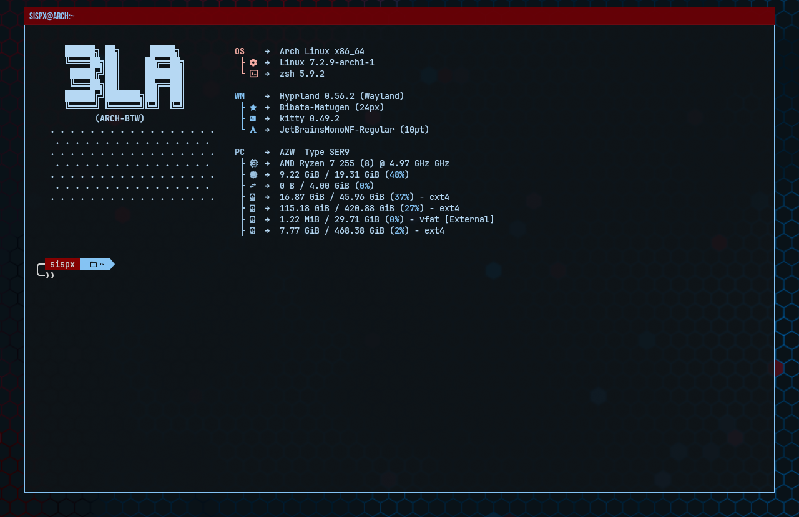
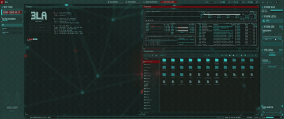

# 3LA-TitleBars

Draws a solid-colour bar above every window's top edge, with the window's own
title rendered on it. The space is *reserved*, like a real title bar: the
window's content is pushed down by `height + gap.top + gap.bottom` and the bar
sits above it rather than painting over the app's own top pixels.



*A title bar reserved above a kitty, showing the window's own title.*



*On a live desktop, with some windows relabelled by `title_rules`.
([mp4](../assets/titlebars-demo.mp4))*

Part of [Hypr-3LA](../README.md).

## Contents

- [Build and load](#build-and-load)
- [Config](#config)
- [Custom titles](#custom-titles)
- [Toggling a bar per-window](#toggling-a-bar-per-window)
- [Example config](#example-config)
- [Notes](#notes)

## Build and load

Requires Hyprland 0.57.0 headers (see the [main README](../README.md#requirements)).
Draws only through Hyprland's renderer API (rect/texture pass elements and
`renderText`), with no raw GL calls.

```sh
make                                              # → 3LA-TitleBars.so
hyprctl plugin load "$PWD/3LA-TitleBars.so"       # absolute path required
```

At startup, `hl.plugin.load("/abs/path/to/3LA-TitleBars.so")` in
`hyprland.lua` (see [Loading at startup](../README.md#loading-at-startup-lua-config)),
or via hyprpm: `hyprpm enable 3LA-TitleBars`. Rebuild after every Hyprland
update (`make clean && make`, since plain `make` doesn't track the Hyprland
headers, or `./rebuild-plugins.sh` at the repo root, which keeps the previous
`.so` if a build fails): a build for a different Hyprland commit
refuses to load.

## Config

Defaults shown:

```lua
hl.config({ plugin = { ["3la_titlebars"] = {
    enabled = 1,             -- 0 = off: no bars and no reserved space, applied
                             -- live (windows snap back to their plain geometry)
    height = 24,             -- bar height (px, >= 1); painted 4 px taller, see Notes
    gap = 7,                 -- gap (px, >= 0) above the bar while gap.top = -1
    ["gap.top"] = -1,        -- gap (px) above the bar (-1 = use gap)
    ["gap.bottom"] = 7,      -- gap (px, >= 0) between the bar and the window underneath

    ["col.active"] = "rgba(690005ff)",  -- focused-window bar color
    ["col.inactive"] = 0,               -- unfocused-window bar color.
                                        -- 0 = follow col.active

    ["opacity.active"] = 1.0,   -- opacity (0..1) of the bar, its text and its
    ["opacity.inactive"] = 1.0, -- shadow: the bar's own stand-in for
                                -- decoration:active_opacity/inactive_opacity,
                                -- which it ignores

    shadow = 1,                    -- soft shadow behind the bar (0 = off).
                                   -- also off whenever decoration:shadow:enabled
                                   -- is false
    ["shadow.size"] = 20,          -- spread distance (device px, >= 0)
    ["shadow.strength"] = 0.5,     -- overall intensity (0..1)
    ["shadow.col"] = "rgba(000000aa)", -- translucent black

    ["text.size"] = 12,                     -- title font size (px, >= 1)
    ["text.font"] = "",                     -- title font family (empty = follow misc:font_family)
    ["text.col.active"] = "rgba(ffffffff)", -- title text color, focused window
    ["text.col.inactive"] = 0,              -- title text color, unfocused window.
                                            -- 0 = follow text.col.active

    ignore_class = "",  -- regex of window classes to never give a title bar (empty = none)
    ignore_title = "",  -- regex of window titles to never give a title bar (empty = none)

    title_rules = "",   -- custom titles; see "Custom titles" below (empty = none)
} } })
```

Out-of-range values are rejected with a config error, not clamped.
`ignore_class` / `ignore_title` are C++ `std::regex` (ECMAScript) *searches*,
not full matches, so anchor with `^...$`. An invalid one is silently ignored.

Live-tweak and inspect:

```sh
hyprctl eval 'hl.config({ plugin = { ["3la_titlebars"] = { height = 28 } } })'
hyprctl getoption plugin:3la_titlebars:height
```

## Custom titles

`title_rules` overrides the text shown on the bar without touching the
window's real title (used elsewhere for matching, alt-tab, etc., and by
`ignore_title`). It packs a list of rules into one string, since a plugin can
register typed config values but not a repeatable rule keyword:

```lua
-- 'class_regex,title_regex,override text' rules, separated by ';'.
-- Either regex may be empty to match any class/title. First match wins.
title_rules = "^(firefox)$,,WEB BROWSER;^(kitty)$,^(btop)$,SYSTEM MONITOR",
```

A window whose class matches `^(firefox)$` (any title) shows "WEB BROWSER"; a
`kitty` window whose title matches `^(btop)$` shows "SYSTEM MONITOR"; every
other window keeps its own title. Override text is uppercased like any title.

- **All 3 fields are required.** Only the first two commas split fields, so
  the override text may contain commas. A rule with fewer than two commas,
  like `^(btop)$,SYSTEM MONITOR`, is skipped; for a title-only rule leave the
  class empty: `,^(btop)$,SYSTEM MONITOR`.
- **One leading space** is dropped from the title regex and the override
  text. The class regex is used as written, so don't put a space after `;`.
- **Regexes are searches** (`std::regex`, ECMAScript), not full matches —
  anchor with `^...$`.
- **Bad rules are skipped individually** (missing field, invalid regex) with
  an in-session notification naming the rule and why.
- Re-parsed only when the string changes.

The same format is used by 3LA-MilSpec's
[`title_rules`](../3LA-MilSpec/README.md#custom-bar-titles), so one string can
drive both.

## Toggling a bar per-window

`hl.plugin.titlebars.toggle()` flips the bar on the currently **focused**
window only; its reserved space follows. It is reversible, but can only hide
a bar: an `ignore_class` / `ignore_title` match still wins. The per-window
state resets when the plugin is reloaded.

```lua
-- hl.plugin.titlebars only exists while the plugin is loaded, hence the pcall
hl.bind("SUPER + SHIFT + B", function()
    pcall(function() hl.plugin.titlebars.toggle() end)
end, { description = "Toggle title bar on active window" })
```

For one-off testing: `hyprctl eval 'hl.plugin.titlebars.toggle()'`.

## Example config

Themed from matugen colour globals (`primary`, `secondary_container`,
`shadow` — whatever your colour template defines), with a shared
`title_rules` string and some ignore lists:

```lua
local title_rules = table.concat({
    ",^(btop)$,SYSTEM MONITOR",
    "^(org.gnome.Nautilus)$,,FILE SYSTEM EXPLORER",
}, ";")

pcall(hl.config, {
    plugin = {
        ["3la_titlebars"] = {
            enabled = 1,
            height = 24,
            ["gap.top"] = 8,
            ["gap.bottom"] = 3,
            ["opacity.active"] = 1.0,
            ["opacity.inactive"] = 0.85,
            ["col.active"] = primary,
            ["col.inactive"] = secondary_container,
            shadow = 1,
            ["shadow.size"] = 9,
            ["shadow.strength"] = 0.5,
            ["shadow.col"] = "rgba(000000ee)",
            ["text.size"] = 16,
            ["text.font"] = "Bebas Neue",      -- fontconfig family (fc-list)
            ["text.col.active"] = on_primary,
            ["text.col.inactive"] = on_secondary_container,
            -- regex of window classes that never get a bar; a literal dot is \\. in Lua
            ignore_class = "^(" .. table.concat({
                "code",
                "chrome-www\\.youtube\\.com__-Default",
            }, "|") .. ")$",
            ignore_title = "",
            title_rules = title_rules,
        }
    }
})
```

## Notes

- The bar is *reserved* space: tiled windows shrink by
  `height + gap.top + gap.bottom`. Within that slot the bar starts `gap.top`
  below the top and is painted `height + 4` px tall, so the visible gap under
  it is `gap.bottom - 4`. With `gap.bottom` under 4 it overlaps whatever sits
  below the slot (normally the window's border).
- The bar is always exactly as wide as the window, flush with the outer edges
  of its border, whatever other decorations reserve around it.
- The title is left-aligned 8 px in from the bar's edge, ellipsised to fit the
  bar minus 8 px each side, and vertically centred. The 8 px padding is in
  device pixels; the font size is `text.size` × the monitor's scale.
- The title text is rendered to a texture and cached per window; it is only
  re-rendered when the text, configured colour, font, size or available width
  change, and repainted immediately on a `window.title` event.
- The title is uppercased (ASCII letters only — accents and icon glyphs pass
  through untouched).
- The window's own drop shadow hugs the core border, not the bar: the
  decoration deliberately leaves `DECORATION_PART_OF_MAIN_WINDOW` off.
- The bar's own `shadow` is a separate effect, not Hyprland's shadow
  renderer: 5 stacked copies of the bar's box, expanded by up to 5/6 of
  `shadow.size` with alpha fading outward (a stepped halo, not a smooth
  blur). `shadow.size` is in device pixels, not multiplied by the monitor's
  scale. Turning off `decoration:shadow:enabled` also turns off the bar's
  shadow; `shadow = 0` disables just the bar's.
- Fullscreen and maximized windows draw no bar. A maximized window still keeps
  its reserved strip, left empty.
- Closing a window never leaves its bar on screen, including clients that
  exit on their own.
- `ignore_class` / `ignore_title` opt windows out entirely (no bar, no
  reserved space). Re-evaluated live on title/class changes, config reload
  and any `hl.config` change.
- The bar, text and shadow ignore the renderer's opacity multiplier (window
  opacity, `decoration:active_opacity` / `inactive_opacity`, fade alpha). The
  bar's alpha is the configured colour's alpha × `opacity.active` /
  `opacity.inactive`; the text and shadow are multiplied by that bar alpha, so
  a fully transparent bar hides its text too.
- A colour of exactly `0` (`rgba(00000000)`) means unset: `col.inactive` and
  `text.col.inactive` follow their active colour, `col.active` falls back to
  opaque red and `text.col.active` to white.
- **With 3LA-Corners**, the top brackets frame the outside of the bar.
  **With 3LA-MilSpec**, the bar is stacked outside the frame and the frame
  grows to enclose it — but that gives two title bars if MilSpec's own is on.
