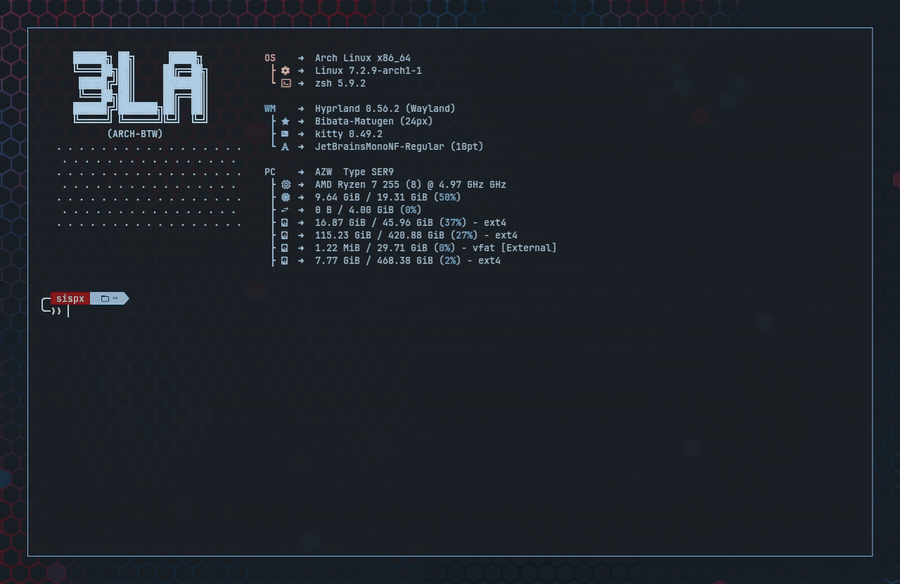
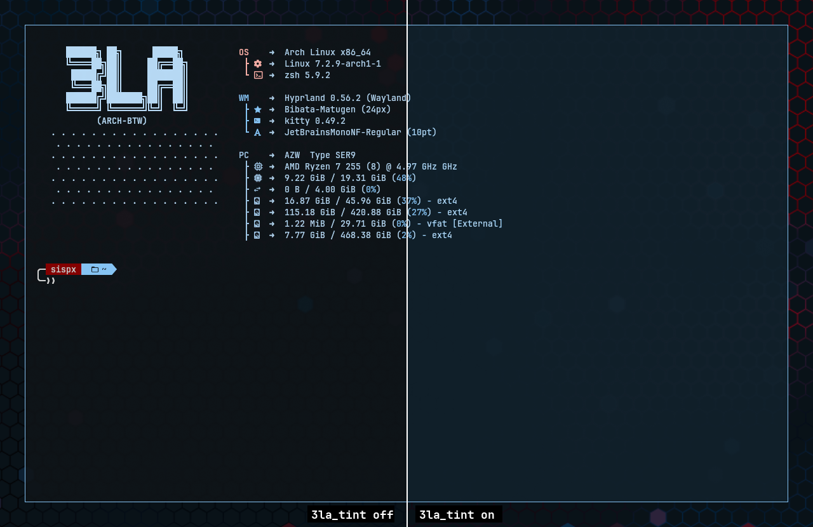

# Hypr-3LA

Hyprland plugins that give a tiling desktop a CCTV / surveillance-rig
aesthetic: chamfered HUD frames, targeting-reticle corner brackets, reserved
title bars, a GLSL "signal lost" window-close effect, and a shader that pulls
un-themeable apps toward your theme colour.

All are C++ Hyprland plugins built against **Hyprland 0.57.0** (`0aa6745`),
configured only through Hyprland's Lua config (`hl.config`), and installable
with `hyprpm`. Every plugin has an `enabled` option that turns it off live
without unloading it.

| plugin | what it does | docs |
|---|---|---|
| [3LA-MilSpec](3LA-MilSpec) | chamfered HUD-panel frame around every window, optional title bar inside it | [README](3LA-MilSpec/README.md) |
| [3LA-Corners](3LA-Corners) | targeting-reticle corner brackets outside every window, with flash and glow | [README](3LA-Corners/README.md) |
| [3LA-GlitchClose](3LA-GlitchClose) | GLSL "signal lost" collapse when a window closes | [README](3LA-GlitchClose/README.md) |
| [3LA-GlitchClose-Viewer](3LA-GlitchClose-Viewer) | WebGL2 tuner for the GlitchClose shader (not a plugin) | [README](3LA-GlitchClose-Viewer/README.md) |
| [3LA-TitleBars](3LA-TitleBars) | solid-colour title bar reserved above every window | [README](3LA-TitleBars/README.md) |
| [3LA-Tint](3LA-Tint) | recolours the greys/blacks/whites of chosen windows toward a theme colour | [README](3LA-Tint/README.md) |

## Plugins

### 3LA-MilSpec

[](3LA-MilSpec/README.md)

Wraps every window in a stroked frame with the **top-left and bottom-right
corners cut at 45°** — a "mil-spec" HUD panel outline. Optionally reserves a
title bar *inside* the frame showing the window's title.

- Per-side title-bar insets, active/inactive colours and opacity, and a
  per-window bar toggle (`hl.plugin.milspec.toggle()`)
- The app's own corners are cut to match: clipped past the frame's outer edge
  (a hook on Hyprland's surface clip) and covered inside it by an
  `offset`-wide band, so the gap stays even along the chamfer
- Background fill between frame and window, and a drop shadow that follows
  the chamfers and replaces Hyprland's rectangular one on framed windows
- Regex opt-outs for the whole frame, just the bar, just the stroke or just
  the shadow, and a bar only for matching titles (e.g. while SSH'd somewhere)
- Custom bar titles (`title_rules`), same format as 3LA-TitleBars
- Drawn with cairo into one cached, antialiased texture per window

→ [Full documentation](3LA-MilSpec/README.md)

### 3LA-Corners

[](3LA-Corners/README.md)

Draws two-segment corner brackets outside every window's border, like a
targeting reticle. The space is reserved, so brackets never overlap
neighbouring windows.

- Separate focused / unfocused colours, decoupled from window opacity
- Flash bursts on window spawn and (optionally) on focus change
- Soft glow during a flash, and optional lines joining the brackets into a
  full frame
- Automatically frames 3LA-TitleBars' bar when both are loaded

→ [Full documentation](3LA-Corners/README.md)

### 3LA-GlitchClose

[](3LA-GlitchClose/README.md)

Plays a CCTV "signal lost" collapse over a window as it closes: the content
tears apart, static and a backdrop ramp in, a `SIGNAL LOST` caption appears,
and only then does the window actually close.

- One GLSL fragment-shader pass per effect per frame: v-sync seam, slice
  tearing, macroblock corruption, ghost copies, chromatic aberration,
  scanlines, static
- `hl.plugin.glitchclose.close()` plays the effect over the still-open window
  before sending the real close; any other close still gets the effect,
  played once the window has left the layout
- Every shader knob and colour is a uniform read each frame — re-theme a
  running effect with no plugin reload
- The window's border is never glitched
- Tunable visually with [3LA-GlitchClose-Viewer](3LA-GlitchClose-Viewer/README.md)
- Draws with raw GL calls through Hyprland's GL renderer

→ [Full documentation](3LA-GlitchClose/README.md)

### 3LA-TitleBars

[](3LA-TitleBars/README.md)

Reserves a solid-colour bar above every window's top edge, with the window's
title drawn on it. The window's content is pushed down rather than painted
over, like a real title bar.

- Active/inactive bar and text colours, opacity and font
- A shadow of its own under the bar, separate from Hyprland's window shadow
- Custom titles per class/title regex (`title_rules`)
- Per-window toggle (`hl.plugin.titlebars.toggle()`) and regex opt-outs

→ [Full documentation](3LA-TitleBars/README.md)

### 3LA-Tint

[](3LA-Tint/README.md)

Built mainly for Google Chrome and GTK apps that don't follow your desktop
theme (and anything else with little or no theming): recolours their grey,
black and white pixels toward one theme colour, keeping each pixel's relative
lightness. Saturated pixels — images, video, coloured UI — are left alone.

- Windows chosen by class or title regex, with class/title exclusions and
  one that applies only while fullscreen or maximized; covers subsurfaces
  and popups
- Tints only what the surface painted, so 3LA-MilSpec's clipped corners and
  client-set visible regions stay untouched
- Smooth chroma-based falloff, so anti-aliased edges don't band
- Damage-only rendering and memoised matching — near-zero cost when idle
- Draws with raw GL calls through Hyprland's GL renderer

→ [Full documentation](3LA-Tint/README.md)

## Demo

Three kitty terminals framed by 3LA-Corners, closed one by one with
3LA-GlitchClose. Setup runs at 2×; the closes are real time:


([full-quality mp4](assets/glitchclose-demo.mp4))

3LA-TitleBars on a live desktop, switching between the tiled layout and a
fullscreen workspace, with some windows relabelled by `title_rules`:


([full-quality mp4](assets/titlebars-demo.mp4))

## Requirements

### To run

| | |
|---|---|
| **Hyprland 0.57.0** | Matched on *commit hash*, not version string, so two 0.57.0 builds from different commits still mismatch — see [Rebuilding after a Hyprland update](#rebuilding-after-a-hyprland-update) |
| **Renderer** | 3LA-GlitchClose and 3LA-Tint make raw GL calls through Hyprland's GL renderer, the only renderer 0.57.0 creates. 3LA-Corners, 3LA-TitleBars and 3LA-MilSpec draw only through renderer pass elements. |
| **Function hooks** | 3LA-MilSpec's corner clip hooks two `CSurfacePassElement` methods by symbol name. If they can't be found or hooked, the plugin says so once at load and paints its corner covers instead; nothing else breaks. |

Nothing else. The built `.so` links only the C/C++ runtime — every Hyprland
and GL symbol is left undefined and resolves against the running compositor
at `dlopen`. The one exception is 3LA-MilSpec, which links `libcairo`;
Hyprland itself depends on cairo, so it is already installed.

### To build

On Arch, everything comes from the official repos:

```sh
sudo pacman -S --needed hyprland gcc make binutils pkgconf
```

| package | provides | why |
|---|---|---|
| `hyprland` | `/usr/include/hyprland`, `hyprland.pc` | the headers the plugins compile against |
| `gcc` | `g++` | the Makefiles ask for `-std=c++26` |
| `make` | `make` | build driver |
| `binutils` | `strip` | release builds are stripped |
| `pkgconf` | `pkg-config` | resolves the include paths |

There is no separate `-devel` split on Arch: the headers ship with the
compositor. **On other distributions** you need the package carrying the
Hyprland headers and `hyprland.pc` (often `hyprland-devel`), or a source build
with headers installed. Verify before building:

```sh
pkg-config --modversion hyprland          # must equal your running compositor
pkg-config --cflags hyprland pixman-1 libdrm cairo
hyprctl version | head -3
```

### Optional

| what | Arch package | needed for |
|---|---|---|
| `python3` | `python` | regenerating the shader tuner's bundle (`make` / `run.sh` in 3LA-GlitchClose-Viewer) |
| `glslangValidator` | `glslang` | `make -C 3LA-GlitchClose-Viewer check` |
| `update-desktop-database` | `desktop-file-utils` | `make -C 3LA-GlitchClose-Viewer install-desktop` |
| a WebGL2 browser | `chromium` / `firefox` / … | opening the tuner (GLSL ES 3.00) |
| `hyprpm`, `git` | `hyprpm`, `git` | only the `hyprpm` route; the `hyprpm` package pulls in the rest of what it needs (`cmake`, `cpio`, `hyprwayland-scanner`) |

## Building and installing

Two routes. **hyprpm** is less to remember and handles rebuilds; **manual** is
better if you are editing the plugins, since it skips the header rebuild. Use
one route or the other for a given plugin, not both.

### Option A — hyprpm

`hyprpm` reads [`hyprpm.toml`](hyprpm.toml), which declares all five plugins.

```sh
hyprpm update                                     # build headers for your Hyprland
hyprpm add https://github.com/ne0tt/Hypr-3LA
hyprpm enable 3LA-MilSpec
hyprpm enable 3LA-Corners
hyprpm enable 3LA-GlitchClose
hyprpm enable 3LA-TitleBars
hyprpm enable 3LA-Tint
hyprpm list                                       # confirm enabled: true
```

`hyprpm update` clones Hyprland at the running commit and builds its own
header set with `cmake`, so the first run takes a few minutes. `hyprpm add`
needs those headers, so run `update` first. Load at every startup from
`hyprland.lua`:

```lua
hl.on("hyprland.start", function()
    hl.exec_cmd("hyprpm reload -n")
end)
```

`commit_pins` in `hyprpm.toml` maps a Hyprland commit to the plugin-repo
commit hyprpm checks out while that Hyprland is running:

| Hyprland | plugin repo |
|---|---|
| 0.57.0 (`0aa6745`) | `0cafa8b` |
| 0.56.2 (`efb5099`) | `d97ba8c` |

Any other Hyprland commit builds the repo's default branch, and
`hyprpm add <url> <rev>` ignores the pins. If you fork this repo, bump the
*second* hash after committing or hyprpm will keep building the pinned
revision.

### Option B — build from source

```sh
git clone https://github.com/ne0tt/Hypr-3LA
cd Hypr-3LA

make -C 3LA-MilSpec
make -C 3LA-Corners
make -C 3LA-GlitchClose
make -C 3LA-TitleBars
make -C 3LA-Tint
```

Each plugin directory is self-contained, with no build order between them.
Targets, identical across every plugin:

| target | effect |
|---|---|
| `make` / `make all` | `-O2`, stripped `.so` |
| `make debug` | clean rebuild with `-g`, not stripped |
| `make clean` | removes the `.so` |

Load into the running compositor (`hyprctl plugin load` needs an **absolute**
path):

```sh
hyprctl plugin load "$PWD/3LA-MilSpec/3LA-MilSpec.so"
hyprctl plugin load "$PWD/3LA-Corners/3LA-Corners.so"
hyprctl plugin load "$PWD/3LA-GlitchClose/3LA-GlitchClose.so"
hyprctl plugin load "$PWD/3LA-TitleBars/3LA-TitleBars.so"
hyprctl plugin load "$PWD/3LA-Tint/3LA-Tint.so"
```

Loading a plugin triggers a config reload, so the settings already in your
config apply as soon as it loads.

### Loading at startup (Lua config)

`hl.plugin.load` takes an absolute path. Replace `/path/to/Hypr-3LA` with
wherever you cloned the repo.

```lua
local HYPR3LA = "/path/to/Hypr-3LA"

hl.plugin.load(HYPR3LA .. "/3LA-MilSpec/3LA-MilSpec.so")
hl.plugin.load(HYPR3LA .. "/3LA-Corners/3LA-Corners.so")
hl.plugin.load(HYPR3LA .. "/3LA-GlitchClose/3LA-GlitchClose.so")
hl.plugin.load(HYPR3LA .. "/3LA-TitleBars/3LA-TitleBars.so")
hl.plugin.load(HYPR3LA .. "/3LA-Tint/3LA-Tint.so")

require("config.colors")  -- e.g. matugen-generated colour globals
require("config.plugins") -- plugin settings (see each plugin's README)
```

Each plugin also ships an optional `autoload.sh` startup fallback: after a
2 s delay it loads the `.so` via `hyprctl` only if `hyprctl plugin list`
doesn't show it, then re-runs `~/.config/hypr/config/plugins.lua` through
`hyprctl eval` (adapt the path to your layout). It is safe to run repeatedly.

```lua
hl.on("hyprland.start", function()
    hl.exec_cmd(HYPR3LA .. "/3LA-Corners/autoload.sh")
    -- ...one per plugin you use
end)
```

Re-apply settings without restarting Hyprland: `hyprctl reload` re-runs the
whole config; for just the plugin file:

```sh
hyprctl eval 'dofile(os.getenv("HOME") .. "/.config/hypr/config/plugins.lua")'
```

### Verifying the install

```sh
hyprpm list                                        # hyprpm route
hyprctl plugin list                                # either route
hyprctl getoption plugin:3la_glitch_close:duration # a registered option proves init ran
```

### Rebuilding after a Hyprland update

**All plugins must be rebuilt every time Hyprland updates.** Each plugin
compares the Hyprland commit hash it was compiled against with the running
compositor's at load; on a mismatch it raises a *version mismatch*
notification and refuses to load instead of crashing the compositor.

A plain `make` won't rebuild: the Makefiles track only each plugin's own
sources, not the Hyprland headers. Clean first.

```sh
# hyprpm route
hyprpm update && hyprpm reload

# manual route: clean + rebuild every plugin (the viewer is skipped). A
# plugin whose build fails keeps its previous .so; --reload then unloads and
# loads each rebuilt plugin that is currently loaded
./rebuild-plugins.sh --reload

# ...or one plugin by hand (unload first: the same path can't be loaded twice)
make -C 3LA-GlitchClose clean && make -C 3LA-GlitchClose
hyprctl plugin unload "$PWD/3LA-GlitchClose/3LA-GlitchClose.so"
hyprctl plugin load   "$PWD/3LA-GlitchClose/3LA-GlitchClose.so"
```

### Troubleshooting

| symptom | cause | fix |
|---|---|---|
| `Package hyprland was not found in the pkg-config search path` | headers missing or off `PKG_CONFIG_PATH` | install the Hyprland headers; check `pkg-config --modversion hyprland` |
| Notification: *version mismatch* | built against a different Hyprland commit than the running one | rebuild — see above |
| `hyprctl plugin load` returns an error | relative path, or that path is already loaded (`Cannot load a plugin twice!`) | use an absolute path; `hyprctl plugin unload` first |
| `hyprctl keyword` → `unknown request` | Hyprland 0.57.0 has no `keyword` command | `hyprctl eval 'hl.config({...})'` |
| `hyprctl dispatch` errors when calling a plugin function | `dispatch` wraps its argument in `hl.dispatch(...)`; the plugins register no dispatchers | `hyprctl eval 'hl.plugin.<name>.<fn>()'` — see [Lua functions](#lua-functions) |
| `unknown config key 'plugin.…'`, or `hyprctl getoption` → `no such option` | plugin not loaded, or option name misspelled | check `hyprctl plugin list`; guard optional blocks with `hl.get_config` (below) |
| `error setting '…'` | value out of its registered range (rejected, not clamped) | see the ranges in the plugin's README |
| Builds fine, no visible effect | plugin `enabled = 0`, or settings never applied | `hyprctl getoption plugin:<ns>:enabled`; `hyprctl reload` |

## Configuration

Settings are applied with `hl.config`, wrapped in `pcall` so a Lua error in a
plugin block (an undefined colour global, say) can't abort the rest of your
config:

```lua
pcall(hl.config, { plugin = {
    ["3la_milspec"]      = { offset = 10, thickness = 2, chamfer = 15 },
    ["3la_corners"]      = { offset = 10, length = 40, thickness = 1 },
    ["3la_glitch_close"] = { duration = 700, strength = 1.0, text = "SIGNAL LOST" },
    ["3la_titlebars"]    = { height = 24, ["gap.top"] = 7, ["gap.bottom"] = 7 },
    ["3la_tint"]         = { match_class = "^(google-chrome)$", strength = 0.3 },
} })
```

Live-tweak with `hyprctl eval`:

```sh
hyprctl eval 'hl.config({ plugin = { ["3la_glitch_close"] = { strength = 2.0 } } })'
hyprctl getoption plugin:3la_glitch_close:strength
```

`pcall` stops a Lua error, but Hyprland still reports `unknown config key`
**per key** for a plugin that isn't loaded. Guard optional plugins with
`hl.get_config`, which returns `nil` for an unregistered option:

```lua
if hl.get_config("plugin:3la_milspec:enabled") ~= nil then
    hl.config({ plugin = { ["3la_milspec"] = { chamfer = 15 } } })
end
```

Notes:

- A value outside an option's registered range is rejected with a config
  error and the previous value stays; it is not clamped.
- `hyprctl eval` changes fire no config reload. 3LA-MilSpec, 3LA-Corners
  and 3LA-TitleBars still re-reserve their space at once, but a few things
  only refresh on `hyprctl reload` (3LA-GlitchClose's caption, a full
  3LA-Tint re-tint) — see each README.
- Prefer plain `hyprctl getoption` for regex options: `-j` prints backslashes
  unescaped, so the JSON fails to parse.
- All regex options are C++ `std::regex` (ECMAScript), **not** Lua patterns.
  A literal dot is `\\.` inside a Lua string.
- Feeding matugen-generated globals into the `col.*` options re-themes the
  plugins on a config reload, with no plugin reload.

Full option references, defaults and example configs are in each plugin's
README.

### Lua functions

The plugins register no dispatchers. Their actions are Lua functions, which
exist only while the plugin is loaded:

| function | plugin | effect |
|---|---|---|
| `hl.plugin.glitchclose.close()` | 3LA-GlitchClose | plays the collapse over the focused window, then closes it |
| `hl.plugin.titlebars.toggle()` | 3LA-TitleBars | hides / restores the focused window's bar |
| `hl.plugin.milspec.toggle()` | 3LA-MilSpec | hides / restores the focused window's MilSpec title bar |

Call them from a bind through `pcall`, so the bind still works with the
plugin unloaded, or from a shell with `hyprctl eval '<expr>'`:

```lua
hl.bind("SUPER + SHIFT + B", function()
    pcall(function() hl.plugin.titlebars.toggle() end)
    pcall(function() hl.plugin.milspec.toggle() end)
end, { description = "Toggle title bar on active window" })
```

3LA-Corners and 3LA-Tint register none.

## Using plugins together

| combination | result |
|---|---|
| Corners + TitleBars | works well: the top brackets frame the bar |
| MilSpec + TitleBars | works: the frame grows to enclose TitleBars' bar. With MilSpec's own `titlebar = 1` too you get two bars — pick one |
| MilSpec + Corners | not recommended: Corners' top brackets collide with the frame's top edge |
| Tint + any decoration | decorations drawn over the window stay untinted |
| Tint + MilSpec | MilSpec's clipped corners and corner covers are never tinted |
| GlitchClose + anything | independent |

One `title_rules` string can drive both 3LA-TitleBars and 3LA-MilSpec — see
their READMEs.

## Repository layout

```
3LA-MilSpec/              chamfered mil-spec frame (+ optional title bar)
3LA-Corners/              corner brackets decoration
3LA-GlitchClose/          GLSL shader signal-loss collapse
3LA-GlitchClose-Viewer/   WebGL2 tuner for the shader above (not a plugin)
3LA-TitleBars/            solid-colour title bar
3LA-Tint/                 GLSL recolour of a window's grey pixels
assets/                   screenshots and demo recordings
hyprpm.toml               hyprpm manifest + Hyprland/plugin commit pins
rebuild-plugins.sh        clean-rebuild (and optionally reload) every plugin
```

Each plugin directory holds its sources (`main.cpp`, `globals.hpp`, the
decoration or effect class, plus `shader.hpp` in 3LA-GlitchClose and
3LA-Tint), a `Makefile`, `autoload.sh` and a `README.md`; `make` writes the
`.so` beside them.
